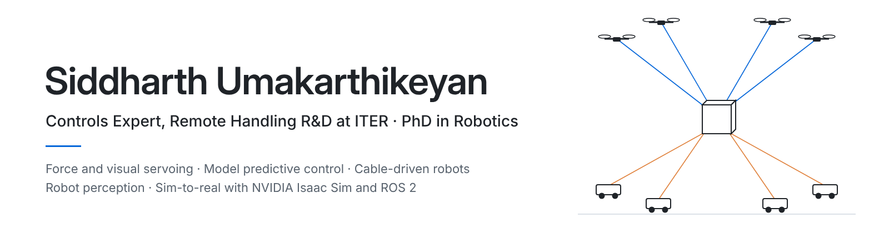

<picture>
  <source media="(prefers-color-scheme: dark)" srcset="assets/banner-dark.png">
  
</picture>

I am a robotics engineer working on control for contact-rich manipulation. At ITER I develop force/torque and visual-servoing control for remote-handling systems. My PhD was on quadrotor-based cable-driven parallel manipulators: modelling, wrench feasibility, MPC and multi-robot planning. Before ITER I built ROS 2 perception and edge-deployment pipelines for warehouse robots at KION Group.

**Contact:** [siddharthumakarthikeyan@gmail.com](mailto:siddharthumakarthikeyan@gmail.com)

## Selected projects

<table>
<tr>
<td width="34%"></td>
<td>
<b><a href="https://siddharthumakarthikeyan.github.io/QCDPM-Isaac-Sim/">Quadrotor-Based Mobile Cable-Driven Parallel Manipulator</a></b> 
<i>Doctoral research · NVIDIA Isaac Sim, C++, ROS 2</i> 
Four quadrotors and four ground robots carry a 6-DoF platform on eight winched cables. Physics-accurate simulation with a C++ estimation and control core; analytical wrench-feasibility results verified in simulation; 1.7 mm mean placement error in block assembly. 
<a href="https://siddharthumakarthikeyan.github.io/QCDPM-Isaac-Sim/">Project page</a> · <a href="https://github.com/siddharthumakarthikeyan/QCDPM-Isaac-Sim">Code</a>
</td>
</tr>
<tr>
<td width="34%"></td>
<td>
<b><a href="https://siddharthumakarthikeyan.github.io/qcdpr-lpv-mpc-fl/">Real-Time LPV-MPC with Feedback Linearisation for a Reconfigurable CDPR</a></b> 
<i>Siddharth Umakarthikeyan, Badri Narayanan R · Python, OSQP</i> 
FL / LPV-MPC cascade for the quadrotors, nonlinear MPC for the ground vehicles, a rate-limited tension QP with a rank-6 cable layout, and an online EKF for payload changes. Millimetre-level tracking; adaptation reduces tracking error by 82–91%. 
<a href="https://siddharthumakarthikeyan.github.io/qcdpr-lpv-mpc-fl/">Project page</a> · <a href="https://github.com/siddharthumakarthikeyan/qcdpr-lpv-mpc-fl">Code</a>
</td>
</tr>
<tr>
<td width="34%"></td>
<td>
<b><a href="https://siddharthumakarthikeyan.github.io/CDPM-Dynamics/">Coupled Dynamics of a Quadrotor-Based Cable-Driven Parallel Manipulator</a></b> 
<i>Doctoral research · MATLAB / Simulink</i> 
Dynamics of eight robots sharing one payload: quadrotor and differential-drive models, unilateral cable forces with slack, and Newton–Euler platform dynamics. 
<a href="https://siddharthumakarthikeyan.github.io/CDPM-Dynamics/">Project page</a> · <a href="https://github.com/siddharthumakarthikeyan/CDPM-Dynamics">Code</a>
</td>
</tr>
<tr>
<td width="34%"></td>
<td>
<b><a href="https://siddharthumakarthikeyan.github.io/Multirobot-Decentralized-Exploration/">Multi-Robot Decentralized Exploration on ROS 2</a></b> 
<i>ROS 2 port of RACER (Zhou, Xu, Shen) · C++, ROS 2 Humble, Docker</i> 
Frontier-based exploration, decentralised MTSP task allocation and B-spline trajectories for a quadrotor swarm, migrated from ROS 1 to ROS 2 Humble across 25 packages, with a containerised build. 
<a href="https://siddharthumakarthikeyan.github.io/Multirobot-Decentralized-Exploration/">Project page</a> · <a href="https://github.com/siddharthumakarthikeyan/Multirobot-Decentralized-Exploration">Code</a>
</td>
</tr>
<tr>
<td width="34%"></td>
<td>
<b><a href="https://siddharthumakarthikeyan.github.io/Underwater-Reconstruction-using-POTROV/">Underwater Structural Reconstruction for the POTROV ROV</a></b> 
<i>Developed for Potential Engineering, India · ROS Noetic, CUDA</i> 
USBL-localised imaging sonar and video fused into 3-D structural maps, with real-time object detection for underwater inspection. 
<a href="https://siddharthumakarthikeyan.github.io/Underwater-Reconstruction-using-POTROV/">Project page</a> · <a href="https://github.com/siddharthumakarthikeyan/Underwater-Reconstruction-using-POTROV">Code</a>
</td>
</tr>
</table>

**Also:** [multifloor-autonomous-navigation](https://github.com/siddharthumakarthikeyan/multifloor-autonomous-navigation) (ROS 2 / Nav2 across floors) · [URDF-viewer-online](https://github.com/siddharthumakarthikeyan/URDF-viewer-online) (client-side URDF viewer) · [Cable-Driven-Parallel-Manipulator](https://github.com/siddharthumakarthikeyan/Cable-Driven-Parallel-Manipulator) (tension distribution in Python) · [ros2-onshape-urdf](https://github.com/siddharthumakarthikeyan/ros2-onshape-urdf) (CAD to ROS 2) · [Radian Labs Academy](https://github.com/Radian-Labs-Academy) (open robotics courses)

## Experience

**ITER Organization**, France · *Controls Expert, Remote Handling R&D* · 2026–present 
Force/torque-guided alignment, insertion and hole search; closed-form inverse kinematics for redundant transporter arms; real-time trajectory, force and visual-servoing loops; Isaac Sim digital twin for sim-first validation; fiducial-based pose estimation.

**KION Group**, India · *Senior Robotics & AI Engineer* · until 2026 
RoCAP digital twin for warehouse automation; ROS 2 case-recognition package with RF-DETR segmentation, stereo depth fusion and tracking at 16–23 ms; TensorRT / DeepStream deployment on NVIDIA Jetson.

**SASTRA Deemed to be University**, India · *PhD in Robotics* · 2025 
Thesis: *Quadrotor-Based Mobile Cable-Driven Parallel Manipulator.*

**BITS Pilani** · *MBA (in progress)*

## Publications

- *Expanding the wrench-feasible workspace of quadrotor-based cable-driven manipulators.* Computers and Electrical Engineering, Elsevier, 2024.
- *Sampling-based 3D path planning for heterogeneous multi-robot cable-driven systems.* Journal of the Brazilian Society of Mechanical Sciences and Engineering, Springer, 2025.
- *CAVIN-360: 360° monocular AMR navigation.* Under review, Robotics and Autonomous Systems.
- *Wrench-Feasibility Atlas for mobile-agent cable-driven parallel robots.* Under review.

## Skills

**Control:** MPC / NMPC, LPV-MPC, feedback linearisation, impedance and admittance control, hybrid force/position control, visual servoing, closed-form IK, tension distribution 
**Learning:** PyTorch, physics-informed neural networks, reinforcement and imitation learning, sim-to-real 
**Perception:** RF-DETR, Mask2Former, instance segmentation, stereo and RGB-D fusion, multi-object tracking, 6-DoF pose estimation, SLAM 
**Software:** ROS 2 (Humble, Jazzy), MoveIt 2, Nav2, Open-RMF, ros2_control · C++, Python, MATLAB 
**Simulation and deployment:** NVIDIA Isaac Sim, Gazebo, Simulink · Jetson, TensorRT, DeepStream, CUDA, Docker
