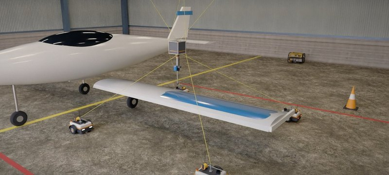

<h1 align="center">Siddharth Umakarthikeyan</h1>

<b>Controls Expert - Remote Handling (R&D), ITER</b> · PhD in Robotics

I develop and validate new methods in control, perception and learning for real robots, and take them from simulation to deployed hardware.

<a href="mailto:siddharthumakarthikeyan@gmail.com">siddharthumakarthikeyan@gmail.com</a>

---

## Research projects

<table>
<tr>
<td width="50%" valign="top">

<h3>Quadrotor-Based Mobile Cable-Driven Parallel Manipulator</h3>
Four quadrotors and four ground robots carry a 6-DoF platform on eight winched cables. Physics-accurate NVIDIA Isaac Sim model with a C++ estimation and control core, analytical wrench-feasibility proofs checked in simulation, and block assembly at 1.7 mm mean placement error.
  <a href="https://siddharthumakarthikeyan.github.io/QCDPM-Isaac-Sim/">Project page</a> · <a href="https://github.com/siddharthumakarthikeyan/QCDPM-Isaac-Sim">Code</a>
</td>
<td width="50%" valign="top">

<h3>Real-Time LPV-MPC with Feedback Linearisation</h3>
FL / LPV-MPC cascade, nonlinear MPC for ground vehicles, a rate-limited tension QP with a rank-6 cable layout, and an online EKF for payload changes. Millimetre-level tracking; adaptation cuts tracking error by 82–91%.
  <a href="https://siddharthumakarthikeyan.github.io/qcdpr-lpv-mpc-fl/">Project page</a> · <a href="https://github.com/siddharthumakarthikeyan/qcdpr-lpv-mpc-fl">Code</a>
</td>
</tr>
<tr>
<td width="50%" valign="top">

<h3>Coupled Dynamics of a Quadrotor-Based CDPM</h3>
MATLAB/Simulink model of eight robots sharing one payload: quadrotor and differential-drive dynamics, unilateral cable forces with slack, and Newton–Euler platform dynamics.
  <a href="https://siddharthumakarthikeyan.github.io/CDPM-Dynamics/">Project page</a> · <a href="https://github.com/siddharthumakarthikeyan/CDPM-Dynamics">Code</a>
</td>
<td width="50%" valign="top">

<h3>Multi-Robot Decentralized Exploration on ROS 2</h3>
ROS 2 Humble port of RACER (Zhou, Xu, Shen): frontier-based exploration, decentralised MTSP task allocation and B-spline trajectories for a quadrotor swarm. 25 packages migrated, containerised build.
  <a href="https://siddharthumakarthikeyan.github.io/Multirobot-Decentralized-Exploration/">Project page</a> · <a href="https://github.com/siddharthumakarthikeyan/Multirobot-Decentralized-Exploration">Code</a>
</td>
</tr>
<tr>
<td width="50%" valign="top">

<h3>Underwater Reconstruction for the POTROV ROV</h3>
USBL-localised imaging sonar and video fused into 3-D structural maps, with real-time object detection, on ROS Noetic and CUDA. Developed for Potential Engineering, India.
  <a href="https://siddharthumakarthikeyan.github.io/Underwater-Reconstruction-using-POTROV/">Project page</a> · <a href="https://github.com/siddharthumakarthikeyan/Underwater-Reconstruction-using-POTROV">Code</a>
</td>
<td width="50%" valign="top">
<h3>More open-source work</h3>
<b><a href="https://github.com/siddharthumakarthikeyan/multifloor-autonomous-navigation">multifloor-autonomous-navigation</a></b>: ROS 2 / Nav2 navigation across building floors  
<b><a href="https://github.com/siddharthumakarthikeyan/URDF-viewer-online">URDF-viewer-online</a></b>: browser-based URDF and xacro viewer, runs fully client-side  
<b><a href="https://github.com/siddharthumakarthikeyan/Cable-Driven-Parallel-Manipulator">Cable-Driven-Parallel-Manipulator</a></b>: Python framework for 8-cable tension distribution and simulation  
<b><a href="https://github.com/siddharthumakarthikeyan/ros2-onshape-urdf">ros2-onshape-urdf</a></b>: Onshape CAD to ROS 2 robot package pipeline  
<b><a href="https://github.com/siddharthumakarthikeyan/Docker-for-ROS2-Jazzy-GZ-Sim">Docker-for-ROS2-Jazzy-GZ-Sim</a></b>: reproducible ROS 2 Jazzy and Gazebo container  
<b><a href="https://github.com/Radian-Labs-Academy">Radian Labs Academy</a></b>: open robotics courses on ROS 2, Open-RMF and Linux for AMRs
</td>
</tr>
</table>

## Experience

**Controls Expert - Remote Handling (R&D)** · ITER, France · 2026 –
- Force/torque-sensor-based control for contact-rich assembly: compliant alignment, insertion and hole search with 6-axis F/T feedback
- Closed-form inverse kinematics for redundant remote-handling transporter arms
- Real-time trajectory, force and visual-servoing control loops for industrial manipulators
- High-fidelity NVIDIA Isaac Sim digital twin of the cell for sim-first validation before hardware trials
- Fiducial-marker-based visual pose estimation for tool and component localisation

**Senior Robotics & AI Engineer** · KION Group, India · until 2026
- RoCAP digital twin for warehouse automation: synthetic data and simulation-based validation of perception
- ROS 2 case recognition package (C++, ROS 2 Humble): RF-DETR instance segmentation, stereo depth fusion, multi-object tracking at 16–23 ms fusion latency
- Edge deployment on NVIDIA Jetson with TensorRT and DeepStream
- Bird's-eye-view carton detection for stacked cases with sliced inference (SAHI) and RGB-D training pipelines

**PhD in Robotics** · SASTRA Deemed to be University, India · 2025
- Thesis: *Quadrotor-Based Mobile Cable-Driven Parallel Manipulator*

**MBA candidate** · BITS Pilani

## Publications

- *Expanding the wrench-feasible workspace of quadrotor-based cable-driven manipulators.* Computers and Electrical Engineering, Elsevier, 2024.
- *Sampling-based 3D path planning for heterogeneous multi-robot cable-driven systems.* Journal of the Brazilian Society of Mechanical Sciences and Engineering, Springer, 2025.
- *CAVIN-360: 360° monocular AMR navigation.* Under review, Robotics and Autonomous Systems.
- *Wrench-Feasibility Atlas for mobile-agent cable-driven parallel robots.* Under review.

## Technical skills

| Area | Tools and methods |
|---|---|
| Control | MPC / NMPC, LPV-MPC, feedback linearisation, impedance and admittance control, hybrid force/position control, visual servoing, closed-form IK, tension distribution |
| Learning | PyTorch, physics-informed neural networks, reinforcement and imitation learning, sim-to-real |
| Perception | RF-DETR, Mask2Former, instance segmentation, stereo and RGB-D fusion, multi-object tracking, 6-DoF pose estimation, SLAM |
| Robotics software | ROS 2 (Humble, Jazzy), MoveIt 2, Nav2, Open-RMF, ros2_control, URDF / USD |
| Simulation | NVIDIA Isaac Sim, Gazebo, CoppeliaSim, MATLAB / Simulink |
| Deployment | NVIDIA Jetson, TensorRT, DeepStream, CUDA, Docker, Linux |
| Languages | C++, Python, MATLAB |

<i>Open to collaboration in robot control, contact-rich manipulation and sim-to-real learning.</i>

