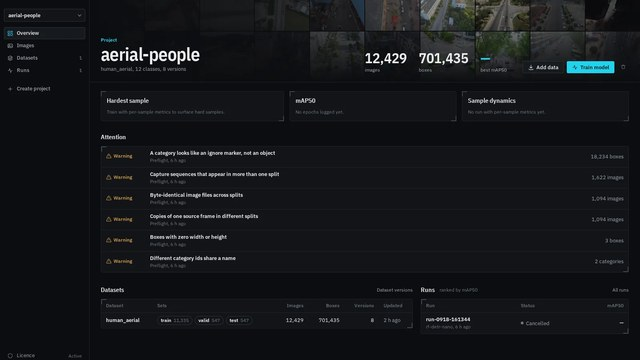
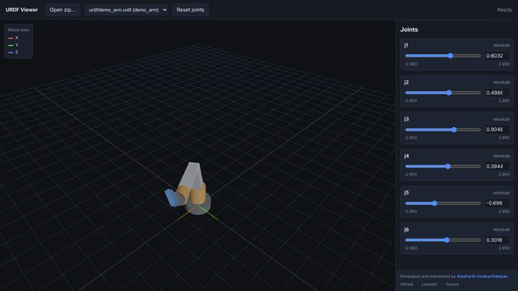
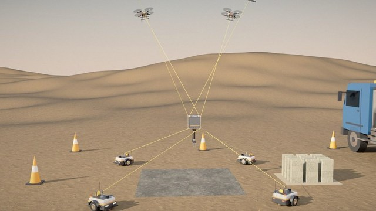
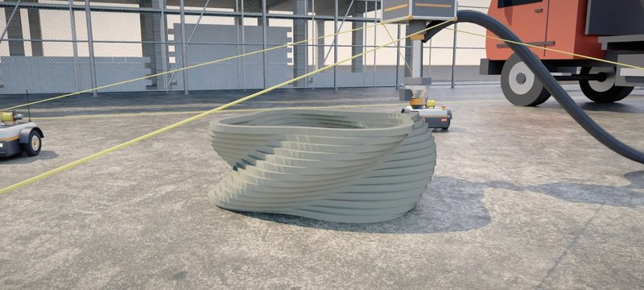
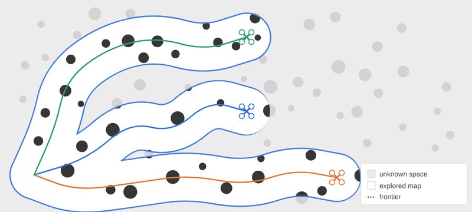
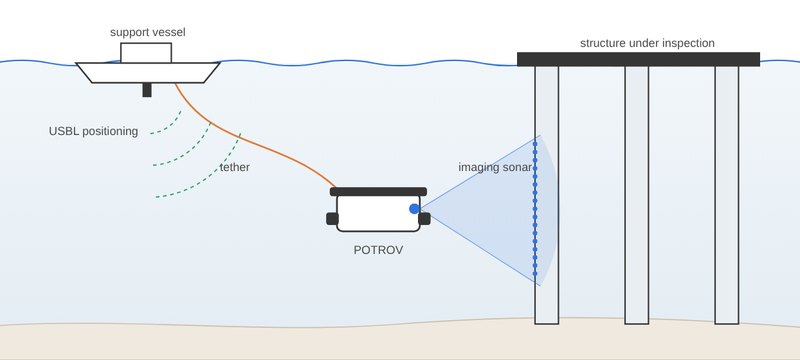
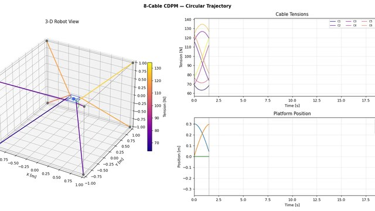
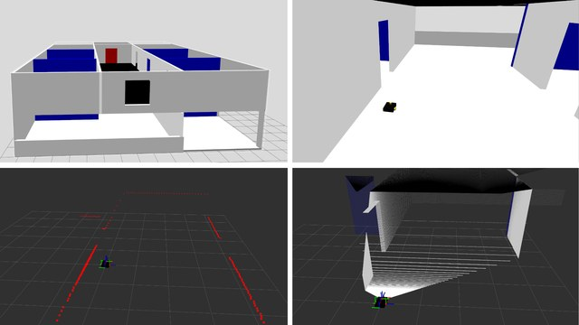

## Siddharth Umakarthikeyan

**Controls Expert, Remote Handling R&D** · ITER Organization, France

I work on control for contact-rich manipulation. My PhD (SASTRA, 2025) was on quadrotor-based cable-driven parallel manipulators: modelling, wrench feasibility, MPC and multi-robot planning. Before ITER I built ROS 2 perception and edge-deployment pipelines for warehouse robots at KION Group.

[Email](mailto:siddharthumakarthikeyan@gmail.com) / [Google Scholar](https://scholar.google.com/citations?user=Rl6gtuoAAAAJ) / [LinkedIn](https://www.linkedin.com/in/siddharthind/)

#### Experience
- **Controls Expert, Remote Handling R&D** · ITER Organization, France · 2026–present 
  Force/torque-guided alignment, insertion and hole search; closed-form inverse kinematics for redundant transporter arms; real-time trajectory, force and visual-servoing loops; Isaac Sim digital twin for sim-first validation.
- **Senior Robotics & AI Engineer** · KION Group, India · until 2026 
  RoCAP digital twin for warehouse automation; ROS 2 case-recognition package with RF-DETR segmentation, stereo depth fusion and tracking; TensorRT / DeepStream deployment on NVIDIA Jetson.
- **PhD in Robotics** · SASTRA Deemed to be University, India · 2025 
  Thesis: *Quadrotor-Based Mobile Cable-Driven Parallel Manipulator.*
- **MBA** · BITS Pilani · in progress

#### Products
<table><tr><td width="200"></td><td><a href="https://siddharthumakarthikeyan.github.io/Granum-AI/"><b>Granum</b></a> Desktop app for computer-vision teams · alpha · Windows and Linux Checks every image and label on import, gives the team one place to review and correct them, and trains YOLO, RT-DETR and RF-DETR on versioned datasets. Runs locally, so data stays with the user. <a href="https://siddharthumakarthikeyan.github.io/Granum-AI/">website</a> / <a href="https://siddharthumakarthikeyan.github.io/Granum-AI/docs/">docs</a> / <a href="https://github.com/siddharthumakarthikeyan/Granum-AI">code</a></td></tr><tr><td width="200"></td><td><a href="https://urdf-viewer-online.vercel.app/"><b>URDF Viewer Online</b></a> Web app · free · Next.js, three.js Drop a zipped ROS package or workspace into the browser and inspect the robot in 3-D with a slider per joint. xacro, STL, DAE, OBJ and glTF supported; runs fully client-side. <a href="https://urdf-viewer-online.vercel.app/">open the app</a> / <a href="https://siddharthumakarthikeyan.github.io/URDF-viewer-online/">project page</a> / <a href="https://github.com/siddharthumakarthikeyan/URDF-viewer-online">code</a></td></tr></table>

#### Research
<table><tr><td width="200"></td><td><a href="https://siddharthumakarthikeyan.github.io/QCDPM-Isaac-Sim/"><b>Quadrotor-Based Mobile Cable-Driven Parallel Manipulator</b></a> Isaac Sim · C++ · ROS 2 Four quadrotors and four ground robots carry a 6-DoF platform on eight winched cables. Isaac Sim model with a C++ estimation and control core. <a href="https://siddharthumakarthikeyan.github.io/QCDPM-Isaac-Sim/">project page</a> / <a href="https://github.com/siddharthumakarthikeyan/QCDPM-Isaac-Sim">code</a></td></tr><tr><td width="200"></td><td><a href="https://siddharthumakarthikeyan.github.io/qcdpr-lpv-mpc-fl/"><b>Real-Time LPV-MPC with Feedback Linearisation</b></a> Python · OSQP FL / LPV-MPC cascade, tension QP and online EKF for a reconfigurable cable-driven robot. Millimetre-level tracking. <a href="https://siddharthumakarthikeyan.github.io/qcdpr-lpv-mpc-fl/">project page</a> / <a href="https://github.com/siddharthumakarthikeyan/qcdpr-lpv-mpc-fl">code</a></td></tr><tr><td width="200"></td><td><a href="https://siddharthumakarthikeyan.github.io/CDPM-Dynamics/"><b>Coupled Dynamics of a Quadrotor-Based CDPM</b></a> MATLAB · Simulink Eight robots sharing one payload: quadrotor, ground-robot and platform dynamics with unilateral cables. <a href="https://siddharthumakarthikeyan.github.io/CDPM-Dynamics/">project page</a> / <a href="https://github.com/siddharthumakarthikeyan/CDPM-Dynamics">code</a></td></tr><tr><td width="200"></td><td><a href="https://siddharthumakarthikeyan.github.io/Multirobot-Decentralized-Exploration/"><b>Multi-Robot Decentralized Exploration on ROS 2</b></a> C++ · ROS 2 · Docker ROS 2 Humble port of RACER: frontier exploration, MTSP allocation and B-spline trajectories for a drone swarm. <a href="https://siddharthumakarthikeyan.github.io/Multirobot-Decentralized-Exploration/">project page</a> / <a href="https://github.com/siddharthumakarthikeyan/Multirobot-Decentralized-Exploration">code</a></td></tr><tr><td width="200"></td><td><a href="https://siddharthumakarthikeyan.github.io/Underwater-Reconstruction-using-POTROV/"><b>Underwater Reconstruction for the POTROV ROV</b></a> ROS · CUDA USBL-localised sonar mapping and real-time object detection for underwater inspection. <a href="https://siddharthumakarthikeyan.github.io/Underwater-Reconstruction-using-POTROV/">project page</a> / <a href="https://github.com/siddharthumakarthikeyan/Underwater-Reconstruction-using-POTROV">code</a></td></tr><tr><td width="200"></td><td><a href="https://siddharthumakarthikeyan.github.io/Cable-Driven-Parallel-Manipulator/"><b>An Open Python Framework for Eight-Cable Driven Parallel Manipulators</b></a> Python · OSQP Kinematics, QP tension distribution with warm-started OSQP, trajectory simulation and visualisation for 8-cable manipulators. <a href="https://siddharthumakarthikeyan.github.io/Cable-Driven-Parallel-Manipulator/">project page</a> / <a href="https://github.com/siddharthumakarthikeyan/Cable-Driven-Parallel-Manipulator">code</a></td></tr><tr><td width="200"></td><td><a href="https://siddharthumakarthikeyan.github.io/multifloor-autonomous-navigation/"><b>Autonomous Mapping and Navigation on ROS 2 Jazzy</b></a> ROS 2 · Gazebo Harmonic · Nav2 Differential-drive robot with lidar and RGB-D: teleoperation, SLAM Toolbox mapping and Nav2 navigation. <a href="https://siddharthumakarthikeyan.github.io/multifloor-autonomous-navigation/">project page</a> / <a href="https://github.com/siddharthumakarthikeyan/multifloor-autonomous-navigation">code</a></td></tr></table>

**Other projects:** [ros2-onshape-urdf](https://github.com/siddharthumakarthikeyan/ros2-onshape-urdf) · [Docker-for-ROS2-Jazzy-GZ-Sim](https://github.com/siddharthumakarthikeyan/Docker-for-ROS2-Jazzy-GZ-Sim) · [Radian Labs Academy](https://github.com/Radian-Labs-Academy)

#### Publications
- *Expanding the wrench-feasible workspace of quadrotor-based cable-driven manipulators.* Computers and Electrical Engineering, 2024.
- *Sampling-based 3D path planning for heterogeneous multi-robot cable-driven systems.* J. Braz. Soc. Mech. Sci. Eng., 2025.
- *CAVIN-360: 360° monocular AMR navigation.* Under review, Robotics and Autonomous Systems.
- *Wrench-Feasibility Atlas for mobile-agent cable-driven parallel robots.* Under review.
